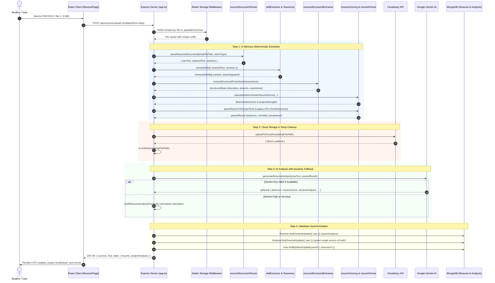
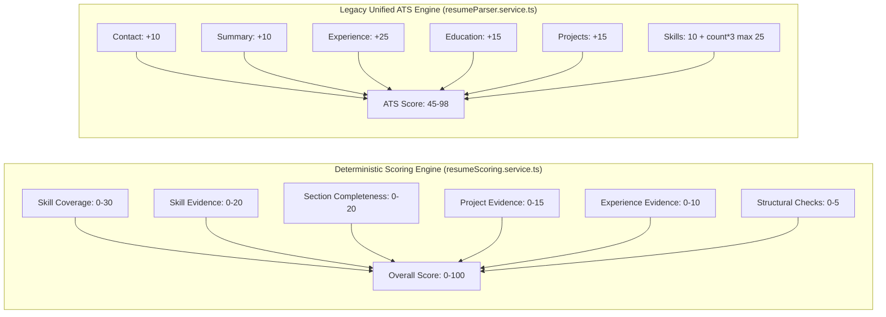
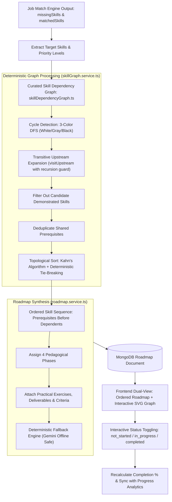
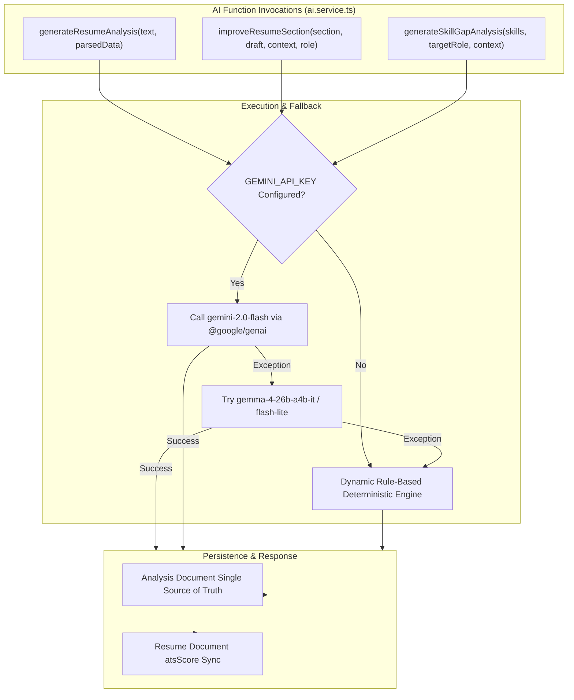
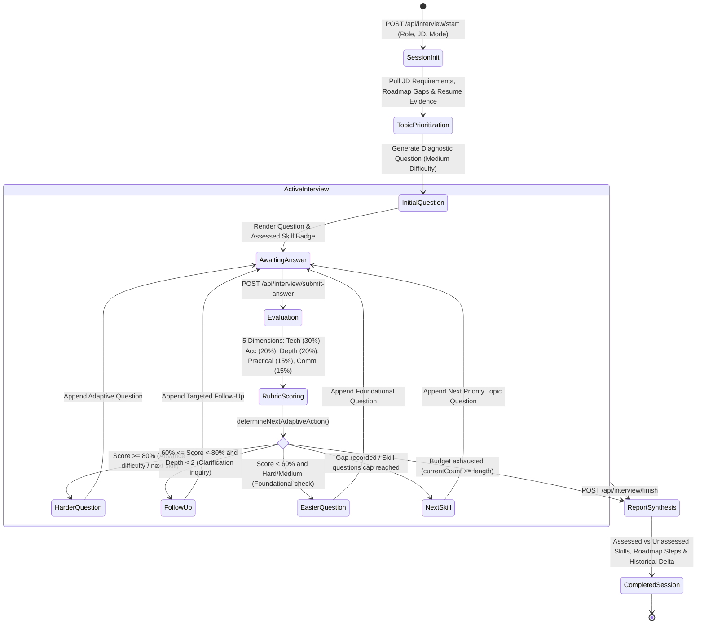
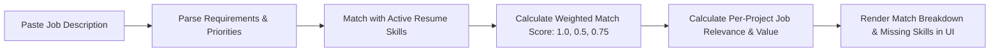
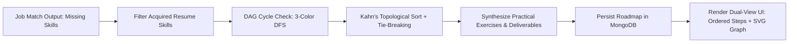
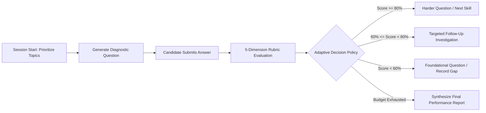

# CareerAI: Comprehensive System Architecture & Implementation Plan

> **Document Type:** Technical Architecture, Algorithm Inventory & Implementation Plan  
> **Repository:** `teekshnasaraf/careerAI`  
> **Audience:** Senior Software Engineers, Technical Evaluators, Project Reviewers, and Future Developers  
> **Status:** Verified against Active Codebase (Backend & Frontend)

---

## 1. Project Overview

### 1.1 Purpose
**CareerAI** is an intelligent full-stack career preparation and resume intelligence platform designed for university students and software engineering aspirants. It combines deterministic Natural Language Processing (NLP), rule-based parsing algorithms, and Large Language Model (LLM) intelligence (via Google Gemini) to deliver:
- Resilient resume text extraction and normalization from PDF and DOCX files.
- Controlled taxonomy-driven technical skill extraction with alias resolution and contextual disambiguation.
- Mathematical, reproducible resume scoring and legacy Applicant Tracking System (ATS) readiness scoring.
- Comprehensive job description matching using priority-weighted matching formulas and evidence mapping.
- Deep project analysis with multi-domain classification and portfolio diminishing returns.
- Interactive AI-powered technical and behavioral mock interview simulations.
- Adaptive skill-gap analysis, personalized learning roadmaps, and profile completeness auditing.

### 1.2 Implemented Features vs. Planned Capabilities
To maintain strict documentation integrity, the repository has been audited directly against active source files:

| Feature / Domain | Implementation Status | Implementation Details & Key Files |
| :--- | :--- | :--- |
| **PDF & DOCX Text Extraction** | **Fully Implemented** | `pdf-parse` v2 class API and `mammoth` buffer extraction in [resumeDocumentParser.service.ts](file:///d:/coding/careerAI/backend/src/services/resumeDocumentParser.service.ts). |
| **Text Cleaning & Section Detection** | **Fully Implemented** | Unicode normalization, mojibake repair, inline heading extraction, and 10 canonical sections in [resumeDocumentParser.service.ts](file:///d:/coding/careerAI/backend/src/services/resumeDocumentParser.service.ts). |
| **Canonical Skill Taxonomy & Extraction** | **Fully Implemented** | 60+ skills across 17 categories, boundary-safe regex, alias resolution, ambiguous word filtering, and rank scoring in [skillExtractor.service.ts](file:///d:/coding/careerAI/backend/src/services/skillExtractor.service.ts) and [skillTaxonomy.ts](file:///d:/coding/careerAI/backend/src/data/skills/skillTaxonomy.ts). |
| **Deterministic Resume Scoring** | **Fully Implemented** | 6-component scoring model (coverage, evidence, completeness, projects, experience, structural) in [resumeScoring.service.ts](file:///d:/coding/careerAI/backend/src/services/resumeScoring.service.ts). |
| **Legacy ATS Scoring & Breakdown** | **Fully Implemented** | Unified ATS scoring engine (45–98 scale) with 6-section checklist and metrics breakdown in [resumeParser.service.ts](file:///d:/coding/careerAI/backend/src/services/resumeParser.service.ts). |
| **Structured Resume Extraction** | **Fully Implemented** | Cohesive entity grouping for education, experience, projects, links, and summaries without LLM hallucination in [resumeStructuredExtractor.service.ts](file:///d:/coding/careerAI/backend/src/services/resumeStructuredExtractor.service.ts). |
| **Per-Project Strength & Domain Analysis** | **Fully Implemented** | 5-factor project strength scorer and 8-domain confidence classifier in [projectAnalysis.service.ts](file:///d:/coding/careerAI/backend/src/services/projectAnalysis.service.ts). |
| **Job Description Parsing & Matching** | **Fully Implemented** | Contextual priority inheritance (`required`, `preferred`, `unspecified`), weighted formula (1.0, 0.5, 0.75), evidence mapping in [jobDescription.service.ts](file:///d:/coding/careerAI/backend/src/services/jobDescription.service.ts) and [jobMatch.service.ts](file:///d:/coding/careerAI/backend/src/services/jobMatch.service.ts). |
| **Project-to-JD Relevance Matching** | **Fully Implemented** | Per-project job value scoring based on required/preferred skill coverage, domain alignment, and responsibility alignment in [projectJobMatching.service.ts](file:///d:/coding/careerAI/backend/src/services/projectJobMatching.service.ts). |
| **Google Gemini AI Pipeline** | **Fully Implemented** | Multi-model fallback (`gemini-2.0-flash` -> `gemma-4-26b-a4b-it` -> `gemini-2.0-flash-lite`) with rule-based fallback in [ai.service.ts](file:///d:/coding/careerAI/backend/src/services/ai.service.ts). |
| **Adaptive AI Interview Engine** | **Fully Implemented** | Dynamic question adaptation, 5-dimension engineering rubric evaluation, decision policy (follow-ups/difficulty tuning), topic prioritization from JD and roadmap gaps, and session recovery in [adaptiveInterview.service.ts](file:///d:/coding/careerAI/backend/src/services/adaptiveInterview.service.ts) and [interview.controller.ts](file:///d:/coding/careerAI/backend/src/controllers/interview.controller.ts). |
| **GitHub Project Evidence Verification** | **Fully Implemented** | SSRF-safe GitHub repository fetching, manifest vs observed dependency analysis, architectural signal extraction, 4-status claim verification rubric, prompt-injection defense, and grounded adaptive interview questions in [githubEvidence.service.ts](file:///d:/coding/careerAI/backend/src/services/githubEvidence.service.ts), [ProjectEvidence.ts](file:///d:/coding/careerAI/backend/src/models/ProjectEvidence.ts), [projectEvidence.controller.ts](file:///d:/coding/careerAI/backend/src/controllers/projectEvidence.controller.ts), and [projectEvidence.service.ts](file:///d:/coding/careerAI/frontend/src/features/projectEvidence/projectEvidence.service.ts). |
| **User Authentication & Authorization** | **Fully Implemented** | Bcrypt hashing, JWT issuance/verification, Zod request body validation in [auth.controller.ts](file:///d:/coding/careerAI/backend/src/controllers/auth.controller.ts) and [auth.middleware.ts](file:///d:/coding/careerAI/backend/src/middleware/auth.middleware.ts). |
| **Cloud File Storage** | **Fully Implemented** | Cloudinary raw resource upload with local disk fallback in [cloudinary.ts](file:///d:/coding/careerAI/backend/src/config/cloudinary.ts). |
| **Skill Dependency Graph & Roadmap** | **Fully Implemented** | Directed acyclic graph (DAG) cycle detection (3-color DFS), topological sorting (Kahn's algorithm with priority tie-breaking), transitive dependency expansion, and interactive personalized roadmap tracking in [skillGraph.service.ts](file:///d:/coding/careerAI/backend/src/services/skillGraph.service.ts), [roadmap.service.ts](file:///d:/coding/careerAI/backend/src/services/roadmap.service.ts), and [Roadmap.ts](file:///d:/coding/careerAI/backend/src/models/Roadmap.ts). |
| **Progress & Dashboard Analytics** | **Fully Implemented** | Live resume, interview progress, and active learning roadmap completion percentage aggregation in [progress.controller.ts](file:///d:/coding/careerAI/backend/src/controllers/progress.controller.ts). |
| **PostgreSQL / Prisma ORM** | **Absent / Not Implemented** | Mentioned in legacy root `README.md`, but the codebase actually uses **MongoDB with Mongoose**. |
| **Email Verification / Password Reset** | **Planned / Absent** | `nodemailer` dependency is installed in `backend/package.json`, but no mail transport or reset token routes exist. |

### 1.3 Technology Stack

#### Backend Stack
- **Runtime & Language:** Node.js (v24.x) & TypeScript (v5.9.2) executing in CommonJS mode.
- **Web Framework:** Express 5.2.1.
- **Database & ODM:** MongoDB with Mongoose 9.7.4.
- **File Ingestion & Parsing:**
  - Multer 2.2.0 (in-memory/disk temporary staging, 5 MB file size limit).
  - `pdf-parse` 2.4.5 (class-based text stream extraction).
  - `mammoth` 1.12.0 (.docx raw XML text extraction).
- **Security & Validation:**
  - `bcrypt` 6.0.0 (password hashing with 10 salt rounds).
  - `jsonwebtoken` 9.0.3 (stateless HS256 JWT tokens).
  - `zod` 4.4.3 (runtime request validation schemas).
  - `cors` 2.8.6.
- **AI & External Services:**
  - `@google/genai` 2.15.0 (Gemini 2.0 Flash / Gemma).
  - `cloudinary` 2.10.0 (cloud storage for resumes).
  - `pino-http` 11.0.0 (structured HTTP logging).

#### Frontend Stack
- **Framework & Tooling:** React 19.2.7 with Vite 8.1.0 and TypeScript.
- **Routing:** React Router DOM 7.18.0 (data router configuration).
- **State Management & Querying:** TanStack React Query 5.101.1 & Axios 1.19.0.
- **Styling & UI:** Tailwind CSS 4.3.1 (`@tailwindcss/vite`), Lucide React icons 1.28.0, and Recharts 3.9.0.
- **Forms & Validation:** React Hook Form 7.80.0 with `@hookform/resolvers` and Zod 4.4.3.

---

## 2. System Architecture

The CareerAI architecture follows a decoupled, service-oriented client-server model. The frontend communicates with the backend via stateless REST APIs secured with JSON Web Tokens.

```mermaid
flowchart TD
    subgraph Frontend ["React 19 Client (Vite)"]
        UI[Pages & Feature Components]
        AxiosClient["Axios Interceptor (Bearer Token)"]
        ReactQuery["TanStack React Query Cache"]
        UI --> AxiosClient
        UI --> ReactQuery
    end

    subgraph BackendGateway ["Express 5 Application Server"]
        Cors["CORS & JSON Body Parser"]
        Logger["Pino HTTP Logger"]
        MulterMW["Multer Upload Middleware (5 MB, PDF/DOCX)"]
        AuthMW["Auth Middleware (JWT Verification)"]
        ValidateMW["Zod Validation Middleware"]
    end

    subgraph Controllers ["Controllers Layer"]
        AuthController["auth.controller"]
        ResumeController["resume.controller"]
        JobController["jobMatch.controller"]
        AnalysisController["analysis.controller"]
        InterviewController["interview.controller"]
        ProgressController["progress.controller"]
        SettingsController["settings.controller"]
        DashController["dashboard.controller"]
    end

    subgraph DeterministicServices ["Deterministic Services (Pure Logic, 0% Hallucination)"]
        DocParser["resumeDocumentParser.service"]
        SkillExtractor["skillExtractor.service & skillTaxonomy"]
        StructuredExtractor["resumeStructuredExtractor.service"]
        ResumeScorer["resumeScoring.service"]
        LegacyAts["resumeParser.service"]
        JDParser["jobDescription.service"]
        JobMatcher["jobMatch.service"]
        ProjectAnalyzer["projectAnalysis.service"]
        ProjectJobMatcher["projectJobMatching.service"]
        ProfileCheck["profileCompleteness.service"]
    end

    subgraph ExternalIntegrations ["External Cloud & AI Services"]
        GeminiAPI["Google Gemini GenAI SDK (@google/genai)"]
        CloudinaryAPI["Cloudinary File Storage"]
        MongoDB[(MongoDB Database)]
    end

    AxiosClient --> Cors
    Cors --> Logger
    Logger --> AuthMW
    AuthMW --> MulterMW
    MulterMW --> ValidateMW

    ValidateMW --> AuthController
    ValidateMW --> ResumeController
    ValidateMW --> JobController
    ValidateMW --> AnalysisController
    ValidateMW --> InterviewController
    ValidateMW --> ProgressController
    ValidateMW --> SettingsController
    ValidateMW --> DashController

    ResumeController --> DocParser
    ResumeController --> SkillExtractor
    ResumeController --> StructuredExtractor
    ResumeController --> ResumeScorer
    ResumeController --> LegacyAts
    ResumeController --> ProjectAnalyzer
    ResumeController --> CloudinaryAPI
    ResumeController --> GeminiAPI
    ResumeController --> MongoDB

    JobController --> JDParser
    JobController --> JobMatcher
    JobController --> ProjectAnalyzer
    JobController --> ProjectJobMatcher
    JobController --> MongoDB

    AnalysisController --> GeminiAPI
    AnalysisController --> MongoDB

    InterviewController --> GeminiAPI
    InterviewController --> MongoDB

    AuthController --> MongoDB
    ProgressController --> MongoDB
    SettingsController --> ProfileCheck
    SettingsController --> MongoDB
    DashController --> MongoDB
```



### 2.1 Request-Response Lifecycle
1. **Client Request:** Frontend initiates request via [api.ts](file:///d:/coding/careerAI/frontend/src/services/api.ts), injecting `Authorization: Bearer <token>` from `localStorage`.
2. **CORS & JSON Parsing:** Express applies `cors` (origin matching `process.env.CLIENT_URL` or `http://localhost:5173`) and `express.json()`.
3. **Pino Logging:** `pinoHttp` logs incoming request headers, IP, and duration.
4. **Authentication:** [auth.middleware.ts](file:///d:/coding/careerAI/backend/src/middleware/auth.middleware.ts) validates token against `process.env.JWT_SECRET` and attaches `req.userId`.
5. **File Ingestion (Upload routes):** [upload.ts](file:///d:/coding/careerAI/backend/src/middleware/upload.ts) stores file in `uploads/resumes/`, validating file type (.pdf, .docx) and file size (≤ 5MB).
6. **Controller Dispatch:** Controller executes deterministic domain services in strict sequence.
7. **External I/O:** Controller coordinates asynchronous calls to Cloudinary and Gemini models with fallback guards.
8. **Persistence:** Models write state to MongoDB with schema timestamps.
9. **Standardized Response:** Returns structured `{ success: true, data: ... }` or errors caught by global error handlers in [app.ts](file:///d:/coding/careerAI/backend/src/app.ts).

---

## 3. Complete Algorithm Inventory

The codebase contains **10 deterministic algorithmic systems**. Every algorithm operates without LLM hallucination and is fully verified by automated unit tests.

### 3.1 Algorithm 1: Document Cleaning & Section Header Detection
- **Source File:** [resumeDocumentParser.service.ts](file:///d:/coding/careerAI/backend/src/services/resumeDocumentParser.service.ts)
- **Functions:** `cleanResumeText()`, `detectResumeSections()`, `extractResumeText()`, `parseResumeDocument()`.
- **Inputs:** Raw binary/file buffer or raw text string; MIME type (`application/pdf`, `application/vnd.openxmlformats-officedocument.wordprocessingml.document`).
- **Outputs:** `ParsedResumeDocument` containing `rawText`, `cleanedText`, and `sections` (a map of 10 keys).
- **Step-by-Step Logic:**
  1. Detect extension and instantiate `PDFParse` for PDF or call `mammoth.extractRawText()` for DOCX.
  2. Normalize newlines: `\r\n` and `\r` converted to `\n`.
  3. Strip control characters: `[\u0000-\u0008\u000B\u000C\u000E-\u001F]`.
  4. Strip non-breaking spaces and zero-width spaces: `[\u00A0\u200B\uFEFF]` -> `" "`.
  5. Fix common PDF extraction mojibake: `•` -> `•`.
  6. Compress multiple horizontal tabs/spaces into single spaces.
  7. Deduplicate blank lines: retain only one blank line between text segments as section boundaries.
  8. Scan line-by-line: evaluate if line is a section header (length ≤ 80 characters, normalized alphanumeric matching against `SECTION_ALIASES`).
  9. Match inline headings via regex: `^(.{1,60}):\s+(.+)$`.
  10. Populate 10 sections: `summary`, `education`, `skills`, `experience`, `projects`, `certifications`, `achievements`, `internships`, `publications`, `extracurricular`.
- **Complexity:** $O(N)$ where $N$ is the number of characters/lines in the resume document.
- **Edge Cases Handled:** Corrupted PDF streams, zero-byte files, multi-line spacing, uppercase headings, punctuation separators (`---`, `===`, `|`).
- **Tests:** `resumeDocumentParser.service.test.ts` (tested indirectly in structured extractor and parser integration tests).

### 3.2 Algorithm 2: Canonical Skill Extraction & Disambiguation
- **Source File:** [skillExtractor.service.ts](file:///d:/coding/careerAI/backend/src/services/skillExtractor.service.ts) & [skillTaxonomy.ts](file:///d:/coding/careerAI/backend/src/data/skills/skillTaxonomy.ts)
- **Function:** `extractSkills({ cleanedText, sections })`.
- **Inputs:** Cleaned text and pre-detected sections map.
- **Outputs:** `SkillExtractionResult` containing `skills: ExtractedSkill[]` and `totalDetectedSkills`.
- **Step-by-Step Logic:**
  1. Extract aliases from [skillTaxonomy.ts](file:///d:/coding/careerAI/backend/src/data/skills/skillTaxonomy.ts).
  2. Sort all aliases descending by character length (`b.alias.length - a.alias.length`) so longest prefixes match first (prevents "Java" from consuming "JavaScript").
  3. Compile boundary-safe regex: `(^|[^A-Za-z0-9])(alias1|alias2|...)(?=$|[^A-Za-z0-9])` with case-insensitivity.
  4. Iterate through populated sections (or fallback to unclassified text).
  5. **Contextual Disambiguation Gate:** If `definition.requiresExplicitSkillContext === true` (e.g., "C", "Go", "R", "Operating Systems"), require that `section === "skills"`. If detected in prose (e.g., "I go to school", "Grade C"), match is discarded.
  6. Accumulate unique canonical names into a Map. Track occurrences, unique section appearances, and exact matched text strings.
  7. Compute deterministic ranking score for each detected skill:
     $$\text{RankingScore} = (\text{Weight} \times 100) + (\text{EvidenceFor}(\text{Sections}) \times 10) + \min(\text{Occurrences}, 3)$$
     Where section evidence weights are: `skills: 4`, `experience: 3`, `projects: 3`, `certifications: 3`, `internships: 3`, `education: 2`, `achievements: 2`, `publications: 2`, `extracurricular: 1`, `summary: 1`, `unclassified: 1`.
  8. Sort skills descending by `rankingScore`, with alphabetical tie-breaking, and assign 1-based sequential `rank`.
- **Complexity:** $O(S \times M)$ where $S$ is section text length and $M$ is total alias count.
- **Tests:** [skillExtractor.service.test.ts](file:///d:/coding/careerAI/backend/src/services/skillExtractor.service.test.ts) (4 unit tests verifying alias ranking, context disambiguation, and boundary safety).

### 3.3 Algorithm 3: Structured Resume Entity Parsing
- **Source File:** [resumeStructuredExtractor.service.ts](file:///d:/coding/careerAI/backend/src/services/resumeStructuredExtractor.service.ts)
- **Functions:** `extractStructuredFromSections()`, `extractSummary()`, `extractEducation()`, `extractExperience()`, `extractProjects()`.
- **Inputs:** Pre-detected `ResumeSections` dictionary.
- **Outputs:** `StructuredParsedData` containing clean `summary`, `experience[]`, `education[]`, `projects[]`, `extracurricular`, and `achievements`.
- **Step-by-Step Logic:**
  - *Summary:* Discards lines matching email/phone/URL regex; concatenates remaining lines; caps at 500 characters. If no summary section exists, returns empty string (never hallucinates from contact header).
  - *Education:* Groups lines by blank lines. Sub-splits lines when a degree qualification regex matches (`B.Tech`, `M.Sc`, `Bachelor`, `Diploma`, `XII`, etc.). Extracts degree title, institution (via keyword regex), date/period (`DATE_PERIOD_RE`), and GPA/score (`SCORE_RE`). Never invents institution or year.
  - *Experience:* Evaluates lines against job title pattern `EXP_TITLE_RE` (`Engineer`, `Developer`, `Intern`, `Architect`, etc.). Bullet points matching `^[•\-*➤▶→►◆◇▸]` are appended to the active position. Non-bullet lines matching uppercase heuristics are classified as company names. Internships and experience sections are combined.
  - *Projects:* Detects project title lines (< 65 characters, capital letter, not a bullet, not starting with action verbs like `Built`, `Developed`, `Implemented`). URLs (`http`, `github.com`) are parsed as metadata `links[]` and attached to the project rather than replacing title or description.
- **Complexity:** $O(L)$ where $L$ is total line count in relevant sections.
- **Tests:** [resumeStructuredExtractor.service.test.ts](file:///d:/coding/careerAI/backend/src/services/resumeStructuredExtractor.service.test.ts) (25 unit tests verifying zero-fabrication, URL link attachment, and record grouping).

### 3.4 Algorithm 4: Deterministic Resume Quality Scoring
- **Source File:** [resumeScoring.service.ts](file:///d:/coding/careerAI/backend/src/services/resumeScoring.service.ts)
- **Function:** `calculateDeterministicResumeScore({ cleanedText, sections, extractedSkills, projectStrengths })`.
- **Inputs:** Cleaned text, sections object, extracted skills array, and optional project strength scores array.
- **Outputs:** `DeterministicResumeScore` containing `overall` (0–100), subscore breakdowns, skill contribution records, strengths, and weaknesses.
- **Step-by-Step Formula & Subscores:**
  Total score is capped at 100 and composed of 6 subscores:
  $$\text{Overall Score} = \text{SkillCoverage} + \text{SkillEvidence} + \text{SectionCompleteness} + \text{ProjectEvidence} + \text{ExperienceEvidence} + \text{StructuralChecks}$$

  1. **Skill Coverage (Max 30):**
     $$\text{SkillCoverage} = \min\left(30, \sum_{s \in \text{UniqueSkills}} \text{Weight}_s\right)$$
  2. **Skill Evidence (Max 20):**
     $$\text{SkillEvidence} = \min\left(10, N_{\text{repeated} \ge 2}\right) + \min\left(10, N_{\text{demonstrated in exp/projects/internships}}\right)$$
  3. **Section Completeness (Max 20):**
     - Summary present ($\ge 30$ chars): $+4$
     - Education present ($\ge 10$ chars): $+4$
     - Skills present ($\ge 2$ chars or count $> 0$): $+4$
     - Projects OR Experience present ($\ge 30$ chars): $+6$ (Student-friendly: either satisfies career evidence)
     - Certifications OR Achievements present ($\ge 10$ chars): $+2$
  4. **Project Evidence (Max 15):**
     - *If `projectStrengths` provided (Portfolio Quality Mode):*
       Projects are sorted descending. Portfolio strength is calculated with diminishing returns using `PORTFOLIO_WEIGHTS = [0.40, 0.25, 0.15, 0.10, 0.05, 0.05]` (subsequent projects contribute $0.02$):
       $$\text{PortfolioRaw} = \sum_{i} \text{Strength}_i \times \text{Weight}_i$$
       $$\text{ProjectEvidence} = \min\left(15, \text{round}\left(\frac{\text{PortfolioRaw}}{100} \times 15\right)\right)$$
     - *If `projectStrengths` omitted (Text Heuristic Mode):*
       Meaningful text ($\ge 50$ chars): $+6$; Taxonomy skills in projects: $+4$; Action verbs present: $+3$; Measurable outcome pattern: $+2$.
  5. **Experience Evidence (Max 10):**
     Meaningful experience/internship text ($\ge 50$ chars): $+4$; Skills demonstrated in experience/internships: $+3$; Action verbs: $+2$; Measurable outcome pattern: $+1$.
  6. **Structural Checks (Max 5):**
     Text length $> 0$: $+1$; Text length $\ge 250$ chars: $+2$; Populated sections $\ge 3$: $+2$.
- **Strengths & Weaknesses Generation:** Deterministic threshold checks (e.g., if coverage $\ge 20 \rightarrow$ "Broad set of recognized technical skills"; if summary missing $\rightarrow$ "Add a concise professional summary or objective").
- **Complexity:** $O(K + P)$ where $K$ is unique skills count and $P$ is project count.
- **Tests:** [resumeScoring.service.test.ts](file:///d:/coding/careerAI/backend/src/services/resumeScoring.service.test.ts) (unit tests for bounded scores, repeatable calculations, and missing section warnings).

### 3.5 Algorithm 5: Legacy Unified ATS Scoring
- **Source File:** [resumeParser.service.ts](file:///d:/coding/careerAI/backend/src/services/resumeParser.service.ts)
- **Function:** `calculateUnifiedAtsScore(data)`.
- **Inputs:** Booleans for `hasSummary`, `hasExperience`, `hasEducation`, `hasProjects`, `hasSkills`, `hasContactInfo`, and `skillsCount`.
- **Outputs:** ATS score integer (clamped between 45 and 98).
- **Formula:**
  $$\text{RawScore} = (\text{Contact} \times 10) + (\text{Summary} \times 10) + (\text{Experience} \times 25) + (\text{Education} \times 15) + (\text{Projects} \times 15) + \min(25, (\text{Skills} \times 10) + \text{skillsCount} \times 3)$$
  $$\text{AtsScore} = \min(98, \max(45, \text{RawScore}))$$
- **Breakdown Components:**
  - `sectionStructureScore`: Sum of found checklist items $\times 5$ (Max 30).
  - `skillsCoverageScore`: $\min(30, \text{skillsCount} \times 4)$.
  - `readabilityScore`: $\min(25, \text{textLength} > 400 \ ? \ 25 : 15)$.
  - `impactMetricsScore`: Numbers/percentages regex match $? \ 15 : 5$.
- **Tests:** [resumeParser.service.test.ts](file:///d:/coding/careerAI/backend/src/services/resumeParser.service.test.ts).

### 3.6 Algorithm 6: Job Description Parsing & Priority Classification
- **Source File:** [jobDescription.service.ts](file:///d:/coding/careerAI/backend/src/services/jobDescription.service.ts)
- **Function:** `parseJobDescription(jobDescription)`.
- **Inputs:** Job description string.
- **Outputs:** `ParsedJobDescription` containing `cleanedText`, `requirements: JobRequirement[]`, and `totalDetectedRequirements`.
- **Step-by-Step Logic:**
  1. Clean text: normalize newlines, collapse multiple spaces.
  2. Maintain `currentPriority` tracker across lines (default `unspecified`).
  3. Priority detection per line:
     - If line matches `requiredMarker` (`required|requirements|must-have|mandatory|essential|minimum qualifications`): priority becomes `required` (Rank 2).
     - If line matches `preferredMarker` (`preferred|nice-to-have|bonus|desired|plus|preferred qualifications`): priority becomes `preferred` (Rank 1).
     - If line matches `neutralSectionMarker` (`responsibilities|about us|what you'll do|overview`): reset to `unspecified` **only if** current priority was already `unspecified`. This prevents neutral sections from downgrading an active required section.
     - Otherwise: inherit `currentPriority` from preceding lines.
  4. Match canonical skills on each line using boundary-safe regex.
  5. **Ambiguity Gate:** Single-word aliases with `requiresExplicitSkillContext: true` (e.g. C, Go, R) only match if priority is explicitly `required` or `preferred`, or line has a priority marker.
  6. **Deduplication:** If a skill appears multiple times in the JD, collapse to a single record. The highest priority encountered wins:
     $$\text{EffectivePriority} = \max(\text{PreviousPriority}, \text{CurrentPriority})$$
  7. Sort requirements alphabetically by name.
- **Complexity:** $O(L \times M)$ where $L$ is JD lines and $M$ is alias count.
- **Tests:** [jobMatch.service.test.ts](file:///d:/coding/careerAI/backend/src/services/jobMatch.service.test.ts) (Tests 22 through 39 validating heading priority inheritance, neutral section behavior, and alias deduplication).

### 3.7 Algorithm 7: Weighted Job Match Scoring
- **Source File:** [jobMatch.service.ts](file:///d:/coding/careerAI/backend/src/services/jobMatch.service.ts)
- **Function:** `calculateJobMatch(requirements, extractedSkills)`.
- **Inputs:** Array of `JobRequirement` and array of candidate's `ResumeSkillForMatch`.
- **Outputs:** `JobMatchResult` containing `overallScore`, `matchedRequired`, `missingRequired`, `matchedPreferred`, `missingPreferred`, `matchedUnspecified`, `missingUnspecified`, `additionalResumeSkills`, and `breakdown`.
- **Deterministic Priority Weights:**
  - $\text{Weight}(\text{required}) = 1.0$
  - $\text{Weight}(\text{preferred}) = 0.5$
  - $\text{Weight}(\text{unspecified}) = 0.75$
- **Exact Verified Match Formula:**
  $$\text{Match Score} = \left(\frac{\sum \text{Weights of matched recognized requirements}}{\sum \text{Weights of all recognized requirements}}\right) \times 100$$
  $$\text{overallScore} = \text{totalWeight} == 0 \ ? \ \text{null} : \frac{\text{round}\left(\frac{\text{matchedWeight}}{\text{totalWeight}} \times 10000\right)}{100}$$
  The final score is rounded to exactly **two decimal places**.
- **Edge Cases & Rules:**
  - **No recognized skills in JD:** `overallScore` is `null`, and `scoreExplanation` is set to `"No recognized skills were found in the job description."`.
  - **Recognized requirements with 0 matches:** `overallScore` is `0.0`.
  - **Duplicate requirements:** Collapsed into one requirement in parser; counted exactly once in scoring.
  - **Additional resume skills:** Tracked in `additionalResumeSkills`; do not inflate numerator or denominator.
  - **Evidence generation:** For matched skills, copies occurrences, sections, and matched texts into `resumeEvidence`.
- **Tests:** [jobMatch.service.test.ts](file:///d:/coding/careerAI/backend/src/services/jobMatch.service.test.ts) (Tests 1 through 21 verifying exact formulas, null returns, and evidence extraction).

### 3.8 Algorithm 8: Project Strength & Domain Classification
- **Source File:** [projectAnalysis.service.ts](file:///d:/coding/careerAI/backend/src/services/projectAnalysis.service.ts)
- **Functions:** `analyzeProject()`, `analyzeProjects()`, `detectProjectDomains()`, `getProjectStrengthScores()`.
- **Inputs:** Project title, description, technologies, and links.
- **Outputs:** `AnalyzedProject` containing `strength` (0–100), `evidence`, `domains[]`, and detected skills.
- **Strength Formula (Max 100):**
  $$\text{Strength} = \min(100, \text{Implementation} + \text{TechDepth} + \text{Outcomes} + \text{Deployment} + \text{Richness})$$
  1. *Implementation Evidence (0–25):* Count of distinct implementation verbs (`built`, `developed`, `optimized`, `engineered`, etc.): $0 \rightarrow 0$, $1 \rightarrow 10$, $2 \rightarrow 18$, $3+ \rightarrow 25$.
  2. *Technical Depth (0–25):* Diminishing returns on unique taxonomy skills: 1st $\rightarrow 10$, 2nd $\rightarrow 7$, 3rd $\rightarrow 5$, 4th $\rightarrow 3$, 5th+ $\rightarrow 0$ (Cap 25).
  3. *Measurable Outcomes (0–20):* Metrics pattern (`%`, `$`, `ms`, user/download count) $\rightarrow 20$; fallback 2-digit number $\rightarrow 10$; none $\rightarrow 0$.
  4. *Deployment / Link Evidence (0–15):* Live demo URL (`vercel.app`, `netlify.app`, etc.) $\rightarrow 15$; Repo URL (`github.com`, etc.) $\rightarrow 10$; other link $\rightarrow 5$; no links $\rightarrow 0$.
  5. *Description Richness (0–15):* Text length brackets: $\le 30 \rightarrow 0$, $31–100 \rightarrow 5$, $101–200 \rightarrow 10$, $201+ \rightarrow 15$.
- **Domain Confidence Formula:**
  Evaluated across 8 predefined domains (`Web Development`, `Mobile`, `AI/ML`, `Data Science`, `Cloud/DevOps`, `Cybersecurity`, `NLP`, `Computer Vision`):
  $$\text{Confidence} = \min\left(1.0, \frac{\text{SkillMatches} \times 2 + \text{KeywordMatches}}{\text{SkillNamesCount} \times 2 + \text{KeywordsCount}}\right)$$
  Emitted only if $\text{Confidence} \ge 0.25$, sorted descending.
- **Tests:** [projectAnalysis.service.test.ts](file:///d:/coding/careerAI/backend/src/services/projectAnalysis.service.test.ts) (11 unit tests).

### 3.9 Algorithm 9: Per-Project Job Relevance & Value
- **Source File:** [projectJobMatching.service.ts](file:///d:/coding/careerAI/backend/src/services/projectJobMatching.service.ts)
- **Function:** `calculateProjectRelevance(analyzedProjects, parsedJd)`.
- **Inputs:** Array of `AnalyzedProject` and `ParsedJobDescription`.
- **Outputs:** Array of `ProjectJobRelevance` containing `relevanceScore` (0–100) and `jobValue` (0–100).
- **Formulas:**
  $$\text{RelevanceRaw} = (C_{\text{req}} \times 0.45) + (C_{\text{pref}} \times 0.20) + (A_{\text{domain}} \times 0.20) + (A_{\text{resp}} \times 0.15)$$
  $$\text{RelevanceScore} = \min(100, \text{round}(\text{RelevanceRaw} \times 100))$$
  Where:
  - $C_{\text{req}} = \frac{\text{matched required}}{\text{total required}}$ (1.0 if JD has no required skills).
  - $C_{\text{pref}} = \frac{\text{matched preferred}}{\text{total preferred}}$ (1.0 if JD has no preferred skills).
  - $A_{\text{domain}}$: Weighted Jaccard between project domains and JD inferred domains.
  - $A_{\text{resp}}$: Fraction of project taxonomy skills appearing in raw JD text prose.
  - **Job Value Formula:**
    $$\text{JobValue} = \min(100, \text{round}(\text{ProjectStrength} \times 0.40 + \text{RelevanceScore} \times 0.60))$$
- **Tests:** [projectJobMatching.service.test.ts](file:///d:/coding/careerAI/backend/src/services/projectJobMatching.service.test.ts) (4 unit tests).

### 3.10 Algorithm 10: Profile Completeness Audit
- **Source File:** [profileCompleteness.service.ts](file:///d:/coding/careerAI/backend/src/services/profileCompleteness.service.ts)
- **Functions:** `getMissingProfileFields()`, `isProfileComplete()`, `isFilled()`.
- **Required Profile Fields:** Full name, College / University, Degree & major, Graduation year, LinkedIn profile.
- **Required Career Fields:** Preferred target role, Career goal, Work setup preference.
- **Excluded Optional Fields:** Phone, CGPA, bio, portfolio, GitHub, avatar URL.
- **Tests:** [profileCompleteness.service.test.ts](file:///d:/coding/careerAI/backend/src/services/profileCompleteness.service.test.ts) (17 unit tests).

---

## 4. Resume Processing Pipeline

The resume ingestion and parsing workflow executes in a strict deterministic sequence, followed by asynchronous cloud persistence and AI enhancement.



---

## 5. Resume Parsing and Skill Extraction Details

### 5.1 Text Extraction Libraries
- **PDF Extraction:** Handled via `pdf-parse` v2. The implementation instantiates `new PDFParse({ data: fileBuffer })`, awaits `parser.getText()`, and ensures `parser.destroy()` is executed inside a `finally` block to prevent file descriptor leaks.
- **DOCX Extraction:** Handled via `mammoth.extractRawText({ buffer: fileBuffer })`.

### 5.2 Normalization Pipeline
1. `replace(/\r\n?/g, "\n")`: Universal Unix newline normalization.
2. `replace(/[\u0000-\u0008\u000B\u000C\u000E-\u001F]/g, "")`: Removal of ASCII control characters.
3. `replace(/[\u00A0\u200B\uFEFF]/g, " ")`: Translation of non-breaking and byte-order mark spaces.
4. `replace(/•/g, "•")`: Conversion of UTF-8 decoding anomalies into bullet points.
5. Line-by-line whitespace trimming and blank-line collapse.

### 5.3 Section Detection Aliases
The 10 recognized sections and their normalized match phrases:
- **`summary`:** summary, professional summary, profile, professional profile, objective, career objective, about me, overview, personal profile.
- **`education`:** education, academic background, academic qualifications, qualifications, academics, educational details.
- **`skills`:** skills, technical skills, core skills, key skills, professional skills, technical competencies, core competencies, technologies, tools and technologies.
- **`experience`:** experience, work experience, professional experience, employment history, work history, career history, professional background.
- **`projects`:** projects, personal projects, academic projects, relevant projects, key projects, featured projects, technical projects, project experience.
- **`certifications`:** certifications, certificates, licenses and certifications, professional certifications, credentials.
- **`achievements`:** achievements, awards, honors, accomplishments, awards and achievements.
- **`internships`:** internships, internship, internship experience.
- **`publications`:** publications, research publications, papers, research papers.
- **`extracurricular`:** extracurricular activities, extracurriculars, activities, leadership and activities, co curricular activities.

### 5.4 Canonical Taxonomy Structure
Each skill in [skillTaxonomy.ts](file:///d:/coding/careerAI/backend/src/data/skills/skillTaxonomy.ts) has:
- `name`: Official canonical string (e.g. `Node.js`, `C++`, `Microsoft Azure`).
- `category`: One of 17 categories.
- `kind`: `technical-skill`, `tool-platform`, `framework-library`, or `domain-keyword`.
- `aliases`: List of variant spellings (e.g., `["React", "React.js", "ReactJS"]`, `["K8s", "Kubernetes"]`, `["Golang", "Go"]`).
- `weight`: Importance rating (2 to 5).
- `requiresExplicitSkillContext`: Boolean flag guarding single-letter or ambiguous words.

---

## 6. Resume Scoring & ATS Systems

The repository implements **two separate scoring engines**, fulfilling different objectives:



### 6.1 Deterministic Resume Scoring
- **Purpose:** Objective, reproducible engineering rating based on portfolio depth, verified section content, and taxonomy coverage.
- **Rounding:** Integer arithmetic with `Math.min`, `Math.max`, and `Math.round`.
- **Persistence:** Saved in `Resume.deterministicScore`.

### 6.2 Legacy Unified ATS Scoring
- **Purpose:** Emulates enterprise ATS keyword scanners and section presence parsers.
- **Persistence:** Saved in `Resume.atsScore` and `Analysis.atsScore`.
- **Synchronized Fallback:** When Gemini is offline, [buildResumeAnalysisPayload](file:///d:/coding/careerAI/backend/src/services/resumeParser.service.ts) calculates `resumeScore = Math.min(98, Math.max(50, atsScore + 5))`.

---

## 7. Job Description Matching System

### 7.1 Architecture & Workflow

```mermaid
flowchart TD
    JDInput[Raw Job Description Text] --> JDParser[jobDescription.service.ts]
    JDParser --> LinePriority[Track Line Priority: required / preferred / unspecified]
    LinePriority --> AmbiguityFilter[Disambiguation: C, Go require priority marker]
    AmbiguityFilter --> DedupRequirements[Collapse Mentions: Highest Priority Wins]
    DedupRequirements --> ParsedJD[ParsedJobDescription: requirements[]]

    ResumeData[Resume Extracted Skills] --> Matcher[jobMatch.service.ts]
    ParsedJD --> Matcher

    Matcher --> CalcWeights[Calculate Total & Matched Weights]
    CalcWeights --> ExactFormula["Match Score = (Matched Weight / Total Weight) * 100"]
    ExactFormula --> RoundResult["Round to 2 Decimal Places (Math.round(x * 10000) / 100)"]

    RoundResult --> GroupResults[Group Into Match Breakdown Categories]
    GroupResults --> Out1[matchedRequired / missingRequired]
    GroupResults --> Out2[matchedPreferred / missingPreferred]
    GroupResults --> Out3[matchedUnspecified / missingUnspecified]
    GroupResults --> Out4[additionalResumeSkills]
```

### 7.2 Priority Weights & Formula Verification
The codebase confirms the exact specified formula in [jobMatch.service.ts](file:///d:/coding/careerAI/backend/src/services/jobMatch.service.ts#L51-L81):

| Requirement Priority | Weight Assigned | Marker Examples in Job Description |
| :--- | :--- | :--- |
| **`required`** | **1.0** | `required`, `must-have`, `mandatory`, `essential`, `minimum qualifications` |
| **`preferred`** | **0.5** | `preferred`, `nice-to-have`, `bonus`, `desired`, `plus`, `preferred qualifications` |
| **`unspecified`** | **0.75** | Skills found in regular job description prose without section markers |

$$\text{Match Score} = \left(\frac{\sum \text{Weights of matched recognized requirements}}{\sum \text{Weights of all recognized requirements}}\right) \times 100$$

### 7.3 Verified Edge Case Behavior
- **No recognized skills in JD:** Returns `overallScore: null`, `scoreExplanation: "No recognized skills were found in the job description."`, and empty arrays for matched/missing lists.
- **Recognized requirements with 0 matches:** Returns `overallScore: 0.0`.
- **Rounding:** Strictly rounded to 2 decimal places:
  ```typescript
  const overallScore = totalWeight === 0 ? null : Math.round((matchedWeight / totalWeight) * 10000) / 100;
  ```
- **Additional resume skills:** Preserved in `additionalResumeSkills: ResumeSkillForMatch[]`. They do not inflate the match score.
- **Duplicate requirements:** Deduplicated in `parseJobDescription`; elevated priority wins (`required` > `preferred` > `unspecified`).
- **Ambiguous skills:** One-letter/ambiguous skills (C, Go, R) only match in JD when found under an explicit `required` or `preferred` context.

### 7.4 Explainable Scoring Capabilities (Phase 1 Implementation)

The system provides comprehensive mathematical transparency, requirement-level evidence tracing, deterministic priority classification reasoning, and prioritized missing-skill action plans:

1. **Requirement-Level Explainability (`JobMatchBreakdown`):**
   - `classificationReason`: Deterministically explains why each requirement was assigned its priority (e.g., explicitly marked via keyword rules like "must have", inherited from surrounding section headings like "Qualifications:", or inferred from general job description text).
   - `resumeEvidence`: Preserves extracted textual quotes, resume sections (`Experience`, `Skills`, `Projects`), and occurrence counts without fabricating confidence percentages.
   - `missingExplanation`: Clear diagnostic explanation for missing skills ("Skill not detected in any analyzed resume section.").
   - `scoreContribution`: Exact weighted percentage contributed by a matched skill to the final score:
     $$\text{scoreContribution} = \left(\frac{w_{\text{skill}}}{W_{\text{total}}}\right) \times 100$$
   - `potentialContribution`: Exact potential score increase if a missing skill is acquired and verified on the resume.

2. **Transparent Mathematical Score Breakdown (`JobMatchScoreBreakdown`):**
   - `totalRecognizedRequirements`, `totalMatchedRequirements`, `totalMissingRequirements`
   - `totalPossibleWeightedScore`, `earnedWeightedScore`, `finalMatchPercentage`
   - `calculationFormula`: Complete string showing dynamic calculation: `(${earnedWeightedScore} / ${totalPossibleWeightedScore}) * 100 = ${finalMatchPercentage}%`
   - `categories`: Per-category (`required`, `preferred`, `unspecified`) breakdown containing item count, matched count, missing count, weight per item, total possible weight, and earned weight.

3. **Deterministic Missing-Skill Prioritization (`prioritizedMissingSkills`):**
   - Ordered deterministically: `required` (1.0 weight) $\rightarrow$ `unspecified` (0.75 weight) $\rightarrow$ `preferred` (0.5 weight), with secondary tie-breaking by potential score impact descending.
   - Generates actionable, role-relevant recommendations explaining why the skill matters based on its job description priority.

4. **Frontend Explainability Panel (`ResumePage.tsx`):**
   - 4-card metric overview (Overall Job Match Score, Required Skills, Preferred Skills, Unspecified Skills).
   - Collapsible Mathematical Score Breakdown panel with formula and category weights table.
   - Prioritized Missing Skills Action Plan with rank, weight, potential score boost, and recommendation.
   - Requirement-by-Requirement Evidence & Classification Explorer with interactive filter tabs (`All`, `Matched`, `Missing`), classification reasons, and extracted resume evidence snippets.


---

## 8. Skill Dependency Graph & Intelligent Learning Roadmap (Phase 2 Implementation)

### 8.1 Architecture & Workflow

Phase 2 extends CareerAI from identifying missing job skills to generating a mathematically validated, topologically ordered, personalized learning roadmap that accounts for prerequisites, candidate existing skills, and job requirement priorities.



### 8.2 Graph Representation & Curated Taxonomy Relationships

The skill dependency graph models skills as nodes and prerequisite requirements as directed edges ($A \rightarrow B$, where $A$ must be mastered before $B$ can be effectively learned).

1. **Graph Node Schema (`SkillGraphNode`):**
   - `canonicalName`: Standardized taxonomy skill name (normalized from aliases).
   - `category`: Taxonomy category (e.g., `Programming Languages`, `Web Technologies`, `Databases`).
   - `acquired`: Boolean indicating if candidate's resume provides verified evidence of the skill.
   - `jobRequirementLevel`: Direct job requirement status (`required`, `preferred`, `unspecified`, or `none` for indirect prerequisites).
   - `isPrerequisite`: Boolean indicating if other skills in the roadmap or taxonomy depend on this node.
   - `learningStatus`: Interactive progress status (`not_started`, `in_progress`, `completed`).
   - `prerequisites`: Array of canonical prerequisite skill names.
   - `unlocks`: Array of downstream skills made accessible by mastering this node.

2. **Curated Prerequisite Data Source (`skillDependencyGraph.ts`):**
   - All relationships are curated from industry software engineering curricula and standard pedagogical dependencies.
   - Pre-mapped across all canonical skills in `SKILL_TAXONOMY` (e.g., `JavaScript` $\rightarrow$ `TypeScript` $\rightarrow$ `React` / `Node.js` $\rightarrow$ `Express.js`, `SQL` $\rightarrow$ `PostgreSQL` / `MySQL`, `HTML` + `CSS` $\rightarrow$ `Tailwind CSS`, `Python` $\rightarrow$ `Django` / `Flask` / `Data Science Fundamentals` $\rightarrow$ `Machine Learning`).
   - Supports alias canonicalization prior to graph lookup, ensuring variant spellings (e.g. `ReactJS`, `K8s`, `Postgres`) map to valid canonical nodes.

### 8.3 Graph Algorithms & Complexity Analysis

1. **Cycle Detection & DAG Validation:**
   - **Algorithm:** Three-Color Depth-First Search (DFS) with node state tracking:
     - `WHITE` (0): Unvisited node.
     - `GRAY` (1): Node currently on the active recursion stack. If a gray node is revisited, a cycle exists.
     - `BLACK` (2): Node completely processed and verified acyclic.
   - **Cycle Path Extraction:** When a back-edge $(u, v)$ is encountered, the algorithm reconstructs and returns the exact cycle sequence (e.g., `A -> B -> C -> A`).
   - **Verification:** The system pre-validates both the repository's curated graph on startup and any ad-hoc graph configurations, throwing structured validation errors before downstream processing.

2. **Topological Sorting:**
   - **Algorithm:** Kahn's Algorithm (in-degree BFS) augmented with deterministic priority ordering.
   - **Time Complexity:** $\mathcal{O}(V \log V + E)$ where $V$ is the number of active skills in the roadmap and $E$ is the number of prerequisite edges. The $\log V$ factor is introduced by the deterministic priority queue sorting at each zero in-degree step.
   - **Space Complexity:** $\mathcal{O}(V + E)$ to maintain the in-degree map, adjacency list, reverse unlock list, and sorted output buffer.
   - **Rationale:** Kahn's algorithm naturally detects remaining cycles (if sorted node count $< V$) and cleanly enables deterministic, multi-attribute tie-breaking among all currently "ready" skills (in-degree = 0) without stack overflow risks on deep trees.

3. **Transitive Dependency Expansion:**
   - Starting from target missing skills identified by the Phase 1 Job Match engine, the service recursively traverses all upstream prerequisite edges (`visitUpstream`).
   - Employs a recursion-chain guard (`Set<string>`) to prevent stack overflow even on pathological input graphs.
   - **Candidate Skill Evidence Exclusion:** Skills already demonstrated on the candidate's resume (with verified evidence) are marked as `acquired = true`. They are excluded from the actionable learning sequence, and their prerequisite constraints are satisfied for downstream skills.
   - **Shared Prerequisite Deduplication:** Shared prerequisites (e.g., `JavaScript` required by both `React` and `Node.js`) are expanded and deduplicated into a single foundational step.
   - **Unmet Prerequisite Retention:** Prerequisites absent from the raw job description (e.g., `HTTP Fundamentals` for `REST API Development`) are retained as explicit learning milestones.

4. **Deterministic Prioritization & Tie-Breaking Rules:**
   When multiple skills have all their prerequisites satisfied ($\text{in-degree} = 0$), tie-breaking occurs in strict deterministic order:
   1. **Job Requirement Level:** Direct `required` skills (weight 1.0) precede `unspecified` skills (0.75), which precede `preferred` skills (0.5), which precede indirect prerequisite skills.
   2. **Downstream Impact:** Skills that unlock a higher number of downstream roadmap targets are prioritized earlier.
   3. **Lexicographical Tie-Breaker:** Canonical skill name ascending (`localeCompare`) guarantees identical, reproducible roadmap sequences across repeated requests.

### 8.4 Roadmap Generation & Phasing Pipeline

The expanded and topologically sorted skill list is synthesized into a 4-phase pedagogical curriculum:
- **Phase 1: Foundations & Prerequisites:** Foundational tools and programming concepts missing from the candidate's profile (e.g., Git, JavaScript, HTTP, Data Structures).
- **Phase 2: Core Job Requirements:** High-priority, direct `required` skills whose foundations are in place.
- **Phase 3: Secondary & Advanced Requirements:** Remaining required and preferred skills, frameworks, and database architectures.
- **Phase 4: Specializations & Enhancements:** Cloud infrastructure, containerization, CI/CD, and specialized tools.

Each roadmap step contains:
- `skillName`: Canonical skill title.
- `phase`: Assigned learning phase.
- `priority`: Direct requirement level (`required`, `preferred`, `unspecified`, or `prerequisite`).
- `whyItMatters`: Educational explanation citing job requirements or downstream prerequisite dependencies.
- `prerequisites`: Required prerequisite skills that must be learned before this step.
- `unlocks`: Skills unlocked upon mastering this step.
- `learningObjective`: Specific engineering competency to achieve.
- `practicalExercise`: Hands-on coding exercise or tutorial task.
- `projectDeliverable`: Real-world project or feature deliverable demonstrating mastery.
- `completionCriteria`: Measurable criteria for verifying completion.
- `status`: Interactive state (`not_started`, `in_progress`, `completed`).

### 8.5 AI Content Boundary & Deterministic Fallback

To ensure absolute reliability and prevent AI hallucinations from distorting learning paths:
- **Strict Boundary:** Graph construction, prerequisite validation, dependency expansion, and topological ordering are **100% deterministic**. The LLM is never permitted to alter or override prerequisite constraints.
- **Deterministic Educational Templates:** `roadmap.service.ts` includes curated educational templates covering objectives, exercises, deliverables, and completion criteria for all canonical taxonomy skills.
- **Fallback Reliability:** If Google Gemini is unconfigured, rate-limited, or throws an exception, the system seamlessly applies the deterministic templates. Zero API failures surface to the end user.

### 8.6 Database Persistence & User Scoping

- **Mongoose Model (`Roadmap.ts`):**
  - Fields: `userId` (indexed `ObjectId`), `jobTitle`, `jobCompany`, `targetSkills`, `prerequisiteSkills`, `steps` (array of `RoadmapStep`), `totalSteps`, `completedSteps`, `completionPercentage`, `status` (`active`, `completed`, `archived`), timestamps.
  - Strict user-isolation: all queries filter by `req.user.id`.
- **Progress Controller Integration (`progress.controller.ts`):**
  - Connects the user's active `Roadmap` completion percentage with the overall career journey stats, displaying total steps, completed milestones, and active roadmap status.

### 8.7 API Endpoints

| Method | Endpoint | Auth | Purpose |
| :--- | :--- | :--- | :--- |
| `POST` | `/api/jobs/roadmap` | JWT Bearer | Generates a personalized learning roadmap from the job match analysis and active resume. |
| `GET` | `/api/jobs/roadmap` | JWT Bearer | Retrieves the authenticated user's current active learning roadmap. |
| `PATCH` | `/api/jobs/roadmap/step` | JWT Bearer | Updates a step's completion status (`not_started`, `in_progress`, `completed`) and recalculates roadmap completion percentage. |

### 8.8 Frontend Interface Integration (`ResumePage.tsx`)

The roadmap is deeply integrated into the existing Job Match interface under the "Active Resume & Job Match" hub:
1. **Interactive Trigger:** After job description matching, a "Generate Learning Roadmap" action initiates roadmap synthesis.
2. **Dual-View Switcher:**
   - **Ordered Learning Steps View:** Displays chronological cards organized by phase, with progress counters, prerequisites badges, unlocked skills badges, practical exercise and deliverable callouts, and interactive status buttons.
   - **Interactive Skill Dependency Graph View:** Visual dependency graph rendering nodes with category and status color-coding, direct job requirement badges, dependency arrows, and a comprehensive legend explaining acquired skills, missing prerequisites, direct requirements, and unlocked technologies.

---

## 9. AI Integration Pipeline

### 9.1 Integration Details
- **Provider & Library:** Google Gemini using `@google/genai` (v2.15.0).
- **Authentication:** `process.env.GEMINI_API_KEY`.
- **Model Fallback Chain:**
  1. `gemini-2.0-flash` (Primary high-speed reasoning model).
  2. `models/gemma-4-26b-a4b-it` (Secondary open-weights instruct fallback).
  3. `gemini-2.0-flash-lite` (Tertiary low-latency fallback).
  4. Dynamic deterministic rule-based calculation (Offline / Key missing fallback).

### 9.2 AI Workflows & Prompt Specifications



#### Prompt Summaries & Output Contracts
1. **Resume Analysis (`generateResumeAnalysis`):** Prompts the model as a Senior Recruiter & ATS Architect. Returns JSON with: `resumeScore`, `atsScore`, `sectionScores` (summary, skills, experience, education, projects), `sectionAnalysis`, `strengths[]`, `weaknesses[]`, `suggestions[]`, `missingSkills[]`, `recommendedKeywords[]`, `actionVerbs[]`, `formattingSuggestions[]`, `topPriorityImprovements[]`.
2. **Section Improvement (`improveResumeSection`):** Prompts model as an Executive Resume Writer to rewrite candidate's draft section using strong action verbs, metric placeholders, and target role alignment. Returns `{ improvedContent, keyChanges[] }`.
3. **Skill Gap Analysis (`generateSkillGapAnalysis`):** Compares candidate's actual extracted skills against industry requirements for `targetRole`. Produces `{ matchingScore, missingSkills[], missingTechnologies[], prioritySkills[], recommendedProjects[], interviewTopics[], certificationSuggestions[], learningRoadmap[] }`.

---

## 10. Authentication & Security

### 10.1 Registration & Password Security
- User registration requires `fullName`, `email`, and `password`.
- Passwords must be $\ge 6$ characters; hashed using `bcrypt.hash(password, 10)`.
- Emails are normalized via `.toLowerCase().trim()`.
- Unique constraints are enforced at both the Mongoose schema level and in controller queries.

### 10.2 JWT Handling
- Token signed with `jsonwebtoken` using secret `process.env.JWT_SECRET`.
- Expiry configured via `process.env.JWT_EXPIRES_IN` (defaults to `"7d"`).
- Stateless authorization header format: `Authorization: Bearer <token>`.

### 10.3 Middleware & File Security
- [auth.middleware.ts](file:///d:/coding/careerAI/backend/src/middleware/auth.middleware.ts): Decodes JWT payload and populates `req.userId`.
- [validate.ts](file:///d:/coding/careerAI/backend/src/middleware/validate.ts): Zod validation middleware parsing `req.body`. Rejects unformatted requests with `400 Bad Request` and structured field errors.
- [upload.ts](file:///d:/coding/careerAI/backend/src/middleware/upload.ts):
  - Limits file size to 5 MB (`5 * 1024 * 1024` bytes). Exceeding limits returns `413 Payload Too Large`.
  - Validates extension (`.pdf`, `.docx`) and MIME types (`application/pdf`, `application/vnd.openxmlformats-officedocument.wordprocessingml.document`, `application/msword`). Disallowed MIME types return `415 Unsupported Media Type`.
  - Generates collision-resistant filenames: `resume-${userId}-${timestamp}-${random}.${ext}`.

---

## 11. Database Models & Persistence

The active persistence layer uses **MongoDB with Mongoose**.

```mermaid
erDiagram
    User ||--o{ Resume : "owns"
    User ||--o{ Analysis : "owns"
    User ||--o{ InterviewSession : "conducts"
    User ||--o{ Roadmap : "tracks"
    User ||--o{ Progress : "aggregates"
    User ||--o{ ProjectEvidence : "owns"
    Resume ||--o{ ProjectEvidence : "links"
    ProjectEvidence ||--o{ InterviewSession : "grounds"
    User ||--|| UserSettings : "configures"

    User {
        ObjectId _id PK
        string fullName
        string email UK
        string password
        string role "student | admin"
        string resumeUrl
        string profilePicture
        string[] skills
        date createdAt
        date updatedAt
    }

    Resume {
        ObjectId _id PK
        ObjectId user FK
        string originalName
        string fileName
        string fileUrl
        string publicId
        number fileSize
        string mimeType
        string rawText
        string cleanedText
        object sections
        object[] extractedSkills
        object deterministicScore
        number atsScore
        string status "uploaded | processing | parsed | failed"
        object parsedData
        object[] sectionChecklist
        object atsBreakdown
        object[] aiFeedback
        date createdAt
        date updatedAt
    }

    Analysis {
        ObjectId _id PK
        ObjectId user FK
        ObjectId resumeId FK
        number resumeScore
        number atsScore
        object sectionScores
        object sectionAnalysis
        string[] strengths
        string[] weaknesses
        string[] suggestions
        string[] missingSkills
        string[] recommendedKeywords
        string[] actionVerbs
        string[] formattingSuggestions
        string[] topPriorityImprovements
        string targetRole
        object skillGapAnalysis
        date createdAt
        date updatedAt
    }

    ProjectEvidence {
        ObjectId _id PK
        ObjectId user FK
        ObjectId resumeId FK
        string projectTitle
        string repositoryUrl
        string owner
        string repo
        string defaultBranch
        object metadata
        string[] filesScanned
        object[] declaredDependencies
        string[] observedImports
        object[] architecturalSignals
        object[] claimAssessments
        string summary
        object[] interviewQuestions
        date createdAt
        date updatedAt
    }

    InterviewSession {
        ObjectId _id PK
        ObjectId user FK
        ObjectId projectEvidenceId FK
        object projectContext
        string mode
        string difficulty
        number length
        string targetCompany
        string targetRole
        object[] questions
        object[] responses
        number overallScore
        string status "in_progress | completed"
        object report
        date createdAt
        date updatedAt
    }

    Progress {
        ObjectId _id PK
        ObjectId user FK
        object[] scoreHistory
        object[] achievements
        object[] timeline
        object[] weakTopics
        object weeklyCoachReport
        date createdAt
        date updatedAt
    }

    Roadmap {
        ObjectId _id PK
        ObjectId userId FK
        string jobTitle
        string jobCompany
        string[] targetSkills
        string[] prerequisiteSkills
        object[] steps
        number totalSteps
        number completedSteps
        number completionPercentage
        string status "active | completed | archived"
        date createdAt
        date updatedAt
    }

    UserSettings {
        ObjectId _id PK
        ObjectId user FK UK
        object profile
        object career
        object learning
        object aiPreferences
        object notifications
        date createdAt
        date updatedAt
    }
```

---

## 12. Frontend Processing & UI Data Flow

### 12.1 Routing Architecture
Defined in [router.tsx](file:///d:/coding/careerAI/frontend/src/app/router.tsx) using React Router DOM:
- **Public Layout (`MainLayout`):**
  - `/`: [LandingPage](file:///d:/coding/careerAI/frontend/src/pages/Landing/LandingPage.tsx)
- **Auth Layout (`AuthLayout`):**
  - `/login`: [LoginPage](file:///d:/coding/careerAI/frontend/src/pages/Login/LoginPage.tsx)
  - `/register`: [RegisterPage](file:///d:/coding/careerAI/frontend/src/pages/Register/RegisterPage.tsx)
- **Protected Layout (`DashboardLayout` inside `ProtectedRoute`):**
  - `/dashboard`: [DashboardPage](file:///d:/coding/careerAI/frontend/src/pages/Dashboard/DashboardPage.tsx)
  - `/resume`: [ResumePage](file:///d:/coding/careerAI/frontend/src/pages/Resume/ResumePage.tsx)
  - `/analysis`: [AnalysisPage](file:///d:/coding/careerAI/frontend/src/pages/Analysis/AnalysisPage.tsx)
  - `/interview`: [InterviewPage](file:///d:/coding/careerAI/frontend/src/pages/Interview/InterviewPage.tsx)
  - `/progress`: [ProgressPage](file:///d:/coding/careerAI/frontend/src/pages/Progress/ProgressPage.tsx)
  - `/settings`: [SettingsPage](file:///d:/coding/careerAI/frontend/src/pages/Settings/SettingsPage.tsx)

### 12.2 State Management & Network Layer
- **Axios Instance:** Centralized in [api.ts](file:///d:/coding/careerAI/frontend/src/services/api.ts). Injects `careerai_token` from `localStorage` on every outbound request.
- **Auth Context:** [AuthContext.tsx](file:///d:/coding/careerAI/frontend/src/context/AuthContext.tsx) maintains active user state, login handler, registration handler, and logout cleanup.
- **Component States:**
  - `ResumePage`: Controls resume display, PDF viewer, deletion modal, upload replacement modal, active tabs (`ats_insights`, `overview`, `experience`, `education`, `projects`, `job_match`), and job match execution.
  - `AnalysisPage`: Manages AI re-analysis triggers, section rewriting state, target role switcher, and dynamic learning roadmap accordions.
  - `InterviewPage`: Manages session setup (mode, difficulty, length, company, role), question progression, answer inputs, real-time feedback evaluation cards, and final completion summary.

---

## 13. Other Feature Pipelines

### 13.1 Adaptive AI Interview Engine (Phase 3 Implementation)

Phase 3 upgrades the interview simulator from a static questionnaire into a personalized, dynamically adapting technical interview engine that adjusts difficulty, investigates gaps with targeted follow-ups, and evaluates responses using a 5-dimension rubric.



#### 13.1.1 5-Dimension Evaluation Rubric & Mathematical Formulation
Answers are evaluated across 5 documented dimensions using an explicit weighted scoring formula:

$$\text{Overall Score} = \text{round}\Big(0.30 \times \text{TechCorrectness} + 0.20 \times \text{Accuracy} + 0.20 \times \text{Depth} + 0.15 \times \text{PracticalApplication} + 0.15 \times \text{Communication}\Big)$$

| Dimension | Weight | Evaluation Criteria |
| :--- | :---: | :--- |
| **Technical Correctness** | **30%** | Accuracy of programming syntax, core algorithmic principles, architectural terminology, and data models. |
| **Accuracy & Relevance** | **20%** | Direct adherence to the question prompt without evasive generalization or off-topic digressions. |
| **Depth of Explanation** | **20%** | Demonstration of internal mechanics, runtime behaviors, memory trade-offs, and scalability bottlenecks. |
| **Practical Application** | **15%** | Incorporation of concrete implementation patterns, realistic production examples, or code structure. |
| **Communication & Clarity** | **15%** | Structured, concise engineering communication (definition $\rightarrow$ implementation $\rightarrow$ trade-offs). |

#### 13.1.2 Adaptive Decision Policy & Difficulty Progression
The decision policy in [adaptiveInterview.service.ts](file:///d:/coding/careerAI/backend/src/services/adaptiveInterview.service.ts) governs state transitions after every answer evaluation:
- **Strong Performance ($\text{Score} \ge 80\%$):**
  - From `Easy`: Advances to `Medium` on the same skill to evaluate practical application.
  - From `Medium`: Advances to `Hard` to test senior architectural scale and edge cases (if questions on skill $< 2$).
  - From `Hard`: Mastery confirmed; rotates to the next prioritized topic.
- **Partially Correct ($60\% \le \text{Score} < 80\%$):**
  - If `followupDepth < 2`: Launches a targeted `follow_up` question referencing the candidate's exact answer and probing the identified gap.
  - If `followupDepth \ge 2`: Concludes follow-up inquiry and advances to `next_skill` to preserve interview breadth.
- **Weak / Incomplete ($\text{Score} < 60\%$):**
  - If `Hard`: Drops difficulty to `Medium` to assess standard implementations.
  - If `Medium`: Drops difficulty to `Easy` to verify foundational principles.
  - If `Easy`: Records foundational gap, updates skill status to `"weak"`, and rotates to `next_skill` to prevent candidate stalling.
- **Stopping Limits:**
  - Hard budget cap: Stops once total responses reach session length (`5`, `10`, or `20` questions).
  - Maximum 2 questions per skill unless follow-up is actively clarifying an edge case.

#### 13.1.3 Personalization & Topic Prioritization Algorithm
Topics are ranked deterministically by combining multiple data sources:
1. **Direct Required Job Skills (Weight 4.0):** Extracted from job description requirements (`required`).
2. **Roadmap Missing Prerequisites & Gaps (Weight 3.5):** Extracted from candidate's active `Roadmap` document.
3. **Unspecified Job Requirements (Weight 2.5):** Extracted from job description body text.
4. **Preferred Job Requirements (Weight 2.0):** Nice-to-have job skills (`preferred`).
5. **Resume-Demonstrated Skills (Weight 1.8):** Verified skills on candidate's resume (tested for depth verification).
- **Assessed Penalty:** Skills already assessed in the current session are deprioritized below unassessed skills.

#### 13.1.4 Session Recovery & Reliability Architecture
- **Recovery Endpoints:** `GET /api/interview/active` and `GET /api/interview/session/:id` allow candidates to refresh or navigate away without losing progress.
- **Duplicate Guard:** `submitQuestionAnswer` rejects duplicate submissions of the same question ID with `400 Bad Request`.
- **Zero-Hallucination Fallback:** When Gemini is unavailable, rate-limited, or returns invalid JSON:
  - Empty answers immediately score `0` with explicit remediation advice.
  - Non-empty answers are scored deterministically by parsing technical terminology density, structural length, and concept relevance against the 5-dimension rubric.
  - Curated question banks across all taxonomy skills guarantee immediate question delivery.

### 13.2 GitHub Project Evidence Verification (Phase 4 Implementation)

Phase 4 enables candidates to connect GitHub repositories to the technical projects claimed on their resume. The system inspects accessible repository contents via the official GitHub REST API, collects verifiable code-level evidence, differentiates between declared dependencies and actual source imports, detects architectural signals, evaluates claims across 4 standardized evidence statuses, and synthesizes repository-grounded technical interview questions.

#### 13.2.1 Architectural Flow & Security Controls
1. **Server-Side Request Forgery (SSRF) Prevention:**
   - [githubEvidence.service.ts](file:///d:/coding/careerAI/backend/src/services/githubEvidence.service.ts) implements `validateAndNormalizeGitHubUrl`.
   - Rejects non-GitHub domains (`gitlab.com`, `bitbucket.org`, arbitrary URLs).
   - Rejects localhost (`localhost`, `127.0.0.1`, `::1`), link-local metadata addresses (`169.254.169.254`), private IP ranges (`10.x.x.x`, `192.168.x.x`, `172.16-31.x.x`), and embedded credentials (`user:pass@host`).
   - Normalizes valid URLs to canonical `https://github.com/:owner/:repo` and extracts clean `:owner` and `:repo` identifiers.
2. **Safe Resource Boundaries:**
   - **Repository Tree Limits:** Fetches git tree via official GitHub API (`GET /repos/:owner/:repo/git/trees/:branch?recursive=1`), capped at 300 tree entries.
   - **File Size Caps:** Limits individual inspected file fetches to 50 KB (`50 * 1024` bytes) using raw GitHub content endpoints with timeout controls.
   - **Prioritized Scanning:** Files are selectively inspected based on evidence value: manifests (`package.json`, `requirements.txt`, `go.mod`), documentation (`README.md`), test suites, container configs (`Dockerfile`, `docker-compose.yml`), CI/CD workflows (`.github/workflows/`), and core source files (`.ts`, `.js`, `.py`, `.go`, `.java`). Indiscriminate repository downloading is strictly avoided.
3. **Prompt Injection & Untrusted Input Sanitization:**
   - Repository code, README markdown, comments, and commit messages are classified as untrusted user data.
   - `sanitizeForPrompt()` strips delimiter collisions, instruction overrides (`"ignore previous instructions"`, `"system prompt"`), and script tags before passing code snippets into LLM contexts.
   - All interview generation prompts treat repository text strictly as data payloads within delimited blocks.

#### 13.2.2 Manifest Parsing vs. Observed Usage
The evidence engine distinguishes between **declared dependencies** and **observed source imports**:
- **Declared Dependencies:** Extracted deterministically from dependency manifests:
  - Node.js: `dependencies` and `devDependencies` from `package.json`.
  - Python: Pinned packages and libraries from `requirements.txt`.
  - Go: Module dependencies and version declarations from `go.mod`.
- **Observed Source Imports:** Extracted by scanning AST-level import and require patterns across source code files:
  - Regex patterns identify: `import ... from '...'`, `require('...')`, `import ...`, and `from ... import ...`.
- **Significance:** A dependency listed in `package.json` without any matching source import is categorized as declared-only, preventing candidates from artificially inflating match scores by simply adding unused dependencies to manifests.

#### 13.2.3 Architectural Signal Detection
The engine scans repository file paths and source contents to identify six production engineering patterns:
| Signal Pattern | Detection Rules & Triggers | Provenance Files |
| :--- | :--- | :--- |
| **API Routes** | Route handlers, Express `router.get/post`, FastAPI `@app.get/post`, Flask routes. | `src/routes/*`, `controllers/*`, `routes.py`, `api/*` |
| **Database Models** | ORM schemas, Mongoose `new Schema`, Prisma schema, Sequelize definitions, SQLAlchemy models. | `models/*`, `schema.prisma`, `entities/*`, `models.py` |
| **Authentication** | JWT signing/verification, Bcrypt hashing, OAuth flows, passport strategies, session cookies. | `auth/*`, `passport.ts`, `middleware/auth*` |
| **Test Suites** | Unit and integration tests, Jest/Mocha configs, Pytest assertions, testing utilities. | `*.test.ts`, `*.spec.js`, `tests/*`, `jest.config.*` |
| **CI/CD Automation**| GitHub Actions workflows, pipeline definitions, automated build/test steps. | `.github/workflows/*.yml`, `.gitlab-ci.yml` |
| **Containerization**| Docker container definitions, multi-container orchestration. | `Dockerfile`, `docker-compose.yml`, `Containerfile` |

#### 13.2.4 Claim-to-Evidence Matching Rubric & 4 Evidence Statuses
Each resume claim (skill, tool, or framework) associated with the project is matched against repository findings using canonical taxonomy resolution and common ecosystem aliases (e.g., `"PostgreSQL"` matches `pg`, `"MongoDB"` matches `mongoose`, `"Authentication"` matches `jsonwebtoken`/`bcrypt`).

Every claim is assigned one of four distinct, non-inflated statuses:
1. **`supported`:** Direct implementation observed in source imports or architectural models with verified file references and provenance snippets.
2. **`partially_supported`:** Claim is listed as a declared dependency in manifests or described in the README, but no direct source code imports or active usage were located in the scanned files.
3. **`not_found`:** Scanned repository contents did not reveal matching dependencies, imports, or documentation references.
4. **`unable_to_assess`:** File or repository was inaccessible, oversized, unsupported, or repository tree could not be retrieved.

> [!IMPORTANT]
> **Ethical Boundary & Non-Attribution Principle:**
> CareerAI treats repository evidence as supporting or challenging a claim, but **never as definitive proof of authorship or individual competency**. Shared repositories, squash merges, paired programming, and forks limit attribution. Missing evidence is explicitly never classified as proof of a false claim.

#### 13.2.5 Grounded Adaptive Technical Interview Integration
Findings from `ProjectEvidence` seamlessly ground Phase 3's adaptive interview engine:
- `POST /api/interview/start` accepts an optional `projectEvidenceId`.
- The controller verifies candidate ownership of the evidence document and prepends verified project technologies to the prioritized topic queue.
- `generateProjectInterviewQuestions` produces technical questions tied directly to detected file paths, database schemas, API routes, or architectural choices (e.g., querying why Mongoose was chosen, how JWT revocation is handled, or how test coverage is structured).
- Questions retain provenance metadata (`repositoryFinding`, `fileReference`), which are displayed in the interactive interview workbench.

### 13.3 Progress Tracking & Weekly Coach
- **Endpoint:** `GET /api/progress/stats`.
- **Metrics Aggregated:** Current resume score, ATS score, average mock interview score, active learning roadmap completion %, questions solved count, unlocked achievements (6 tiered achievements), chronological timeline, weak topics, and personalized weekly coach guidance.

### 13.4 User Settings & Career Goals
- **Endpoints:** `GET /api/settings`, `PUT /api/settings`.
- **Configurable Sections:**
  - `profile`: Name, college, degree, graduation year, LinkedIn, GitHub, portfolio, bio.
  - `career`: Target role, domain, target companies, preferred location, work type (remote/hybrid/onsite), expected salary, career goal.
  - `learning`: Weekly study hours, learning style, preferred difficulty, roadmap style.
  - `aiPreferences`: Tone, explanation depth, auto-analyze toggle.
  - `notifications`: Email, interview reminders, weekly progress alerts.

---

## 14. API Endpoint Inventory

| HTTP Method | Route Path | Auth Req. | Controller Action | Request Body / Params | Expected Response Shape |
| :--- | :--- | :--- | :--- | :--- | :--- |
| `GET` | `/` | No | Inline handler | None | `{ success: true, message: "CareerAI Backend Running 🚀" }` |
| `POST` | `/api/auth/register` | No | `auth.controller.register` | `{ fullName, email, password }` | `{ success: true, data: { id, fullName, email, role } }` |
| `POST` | `/api/auth/login` | No | `auth.controller.login` | `{ email, password }` | `{ success: true, data: { token, user } }` |
| `GET` | `/api/auth/me` | Yes | `auth.controller.getCurrentUser` | None | `{ success: true, data: { id, fullName, email, role } }` |
| `POST` | `/api/resume/upload` | Yes | `resume.controller.uploadResume` | Multipart `resume` file | `{ success: true, data: { ...resume, projectAnalysis } }` |
| `GET` | `/api/resume/latest` | Yes | `resume.controller.getLatestResume` | None | `{ success: true, data: { ...resume, projectAnalysis } }` |
| `DELETE` | `/api/resume/:id` | Yes | `resume.controller.deleteResume` | URL Param `:id` | `{ success: true, message: "Resume deleted successfully" }` |
| `POST` | `/api/jobs/match` | Yes | `jobMatch.controller.matchJobDescription` | `{ jobDescription, resumeId? }` | `{ success: true, match, projectRelevance, data }` |
| `POST` | `/api/jobs/roadmap` | Yes | `roadmap.controller.generateLearningRoadmap` | `{ jobDescription, resumeId? }` | `{ success: true, roadmap: RoadmapDocument }` |
| `GET` | `/api/jobs/roadmap` | Yes | `roadmap.controller.getActiveRoadmap` | None | `{ success: true, roadmap: RoadmapDocument }` |
| `PATCH` | `/api/jobs/roadmap/step` | Yes | `roadmap.controller.updateRoadmapStepStatus` | `{ roadmapId, skillName, status }` | `{ success: true, roadmap: RoadmapDocument }` |
| `GET` | `/api/analysis/latest` | Yes | `analysis.controller.getLatestAnalysis` | None | `{ success: true, data: AnalysisDocument }` |
| `POST` | `/api/analysis/resume` | Yes | `analysis.controller.runResumeAnalysis` | None | `{ success: true, data: AnalysisDocument }` |
| `POST` | `/api/analysis/improve-section` | Yes | `analysis.controller.improveSection` | `{ sectionType, content }` | `{ success: true, data: { improvedContent, keyChanges } }` |
| `POST` | `/api/analysis/skill-gap` | Yes | `analysis.controller.runSkillGapAnalysis` | `{ targetRole }` | `{ success: true, data: AnalysisDocument }` |
| `GET` | `/api/dashboard/stats` | Yes | `dashboard.controller.getDashboardStats` | None | `{ success: true, data: { resumeUploaded, resumeScore, atsScore, ... } }` |
| `GET` | `/api/interview/stats` | Yes | `interview.controller.getInterviewHistoryStats`| None | `{ success: true, data: { questionsSolved, mockInterviewsCompleted, ... } }` |
| `GET` | `/api/interview/active` | Yes | `interview.controller.getActiveInterviewSession` | None | `{ success: true, data: InterviewSession \| null }` |
| `GET` | `/api/interview/session/:id` | Yes | `interview.controller.getInterviewSessionById` | URL Param `:id` | `{ success: true, data: InterviewSession }` |
| `POST` | `/api/interview/start` | Yes | `interview.controller.startInterviewSession` | `{ mode, difficulty, length, targetCompany, targetRole, isAdaptive?, jobDescription?, projectEvidenceId? }` | `{ success: true, data: InterviewSession }` |
| `POST` | `/api/interview/submit-answer` | Yes | `interview.controller.submitQuestionAnswer` | `{ sessionId, questionId, questionText, userAnswer }` | `{ success: true, data: { sessionId, evaluation, nextQuestion?, isFinished? } }` |
| `POST` | `/api/interview/finish` | Yes | `interview.controller.finishInterviewSession` | `{ sessionId }` | `{ success: true, data: InterviewSession }` |
| `POST` | `/api/project-evidence/analyze` | Yes | `projectEvidence.controller.analyzeProjectEvidence` | `{ repositoryUrl, projectTitle, resumeId?, claimedSkills? }` | `{ success: true, data: ProjectEvidenceDocument }` |
| `GET` | `/api/project-evidence` | Yes | `projectEvidence.controller.getAllUserProjectEvidence` | None | `{ success: true, data: ProjectEvidenceDocument[] }` |
| `GET` | `/api/project-evidence/:id` | Yes | `projectEvidence.controller.getProjectEvidence` | URL Param `:id` | `{ success: true, data: ProjectEvidenceDocument }` |
| `DELETE` | `/api/project-evidence/:id` | Yes | `projectEvidence.controller.deleteProjectEvidence` | URL Param `:id` | `{ success: true, message: "Project evidence deleted successfully" }` |
| `GET` | `/api/progress/stats` | Yes | `progress.controller.getProgressStats` | None | `{ success: true, data: { currentResumeScore, achievements, activeRoadmap, ... } }` |
| `GET` | `/api/settings` | Yes | `settings.controller.getUserSettings` | None | `{ success: true, data: UserSettings }` |
| `PUT` | `/api/settings` | Yes | `settings.controller.updateUserSettings` | `{ profile, career, learning, aiPreferences, notifications }` | `{ success: true, data: UserSettings }` |

---

## 15. Error Handling & Edge Cases

### 15.1 Global Error Handling
Configured in [app.ts](file:///d:/coding/careerAI/backend/src/app.ts):
- Multer `LIMIT_FILE_SIZE`: Returns `413 Payload Too Large` with `"Resume file is too large. Maximum allowed size is 5 MB."`.
- Invalid file type: Returns `415 Unsupported Media Type` with `"Invalid file type. Only PDF and DOCX files are allowed."`.
- Custom `ResumeParserError`: Returns `error.statusCode` (400, 415, or 422) with descriptive validation message.
- Unhandled internal exceptions: Returns `500 Internal Server Error` with generic `"Server error processing request"` to prevent stack trace leaks.

### 15.2 Domain-Specific Edge Cases
- **Empty Resumes / Scanned Images:** Caught by `cleanResumeText()`. If length is zero, throws `ResumeParserError("No readable text could be extracted from this resume. Please upload a text-based PDF or DOCX file.", 422)`.
- **Cloudinary Failures:** Temporary local files in `uploads/resumes/` are guaranteed to be unlinked in `try/finally` blocks even if cloud upload throws an error.
- **Empty Job Description:** Returns `400 Bad Request` if string is empty or missing.
- **JD with No Recognized Skills:** Returns `overallScore: null` and informative explanation without crashing scoring routines.
- **Graph Cycle Detection:** If circular dependencies are introduced in custom dependency definitions, the three-color DFS cycle detector intercepts them and throws a structured error detailing the exact cycle path (`A -> B -> A`).
- **Unknown Skills with No Graph Definitions:** Gracefully handled as isolated target leaf nodes in the roadmap without prerequisites.
- **Missing Gemini API Key:** The system does not crash; it transparently switches to curated educational templates and deterministic rule-based calculation engines.

---

## 16. Testing and Verification

### 16.1 Test Suites Execution
All test suites in the repository run via Node.js's native test runner (`node:test` and `node:assert/strict`) registered through `ts-node`.

**Verification Command Executed:**
```powershell
node -r ts-node/register --test `
  src/services/jobMatch.service.test.ts `
  src/services/profileCompleteness.service.test.ts `
  src/services/projectAnalysis.service.test.ts `
  src/services/projectJobMatching.service.test.ts `
  src/services/resumeParser.service.test.ts `
  src/services/resumeScoring.service.test.ts `
  src/services/resumeStructuredExtractor.service.test.ts `
  src/services/skillExtractor.service.test.ts `
  src/services/skillGraph.service.test.ts `
  src/services/adaptiveInterview.service.test.ts `
  src/services/githubEvidence.service.test.ts
```

### 16.2 Actual Verification Results
- **Total Tests Executed:** 183 tests
- **Passing Tests:** 183
- **Failing Tests:** 0
- **Execution Duration:** ~3.2 seconds
- **Breakdown by Test File:**
  - `githubEvidence.service.test.ts`: 20 tests passed (canonical URL normalization with trailing slash/.git strip, rejection of non-GitHub domains, SSRF protection rejecting localhost and link-local 169.254.169.254, SSRF protection rejecting private IPv4 ranges, rejection of embedded auth credentials in URLs, deterministic package.json manifest parsing, requirements.txt parsing with comment/specifier strip, go.mod module dependency parsing, observed source import extraction from JS/TS and Python, distinction between declared dependencies and observed imports, architectural signal detection for API routes/models/auth/tests/CI-CD/Docker, `supported` status for active source imports and models, `partially_supported` status for manifest-only or doc-only claims, `not_found` status for absent technologies without false accusations, `unable_to_assess` status when tree or file content is empty/inaccessible, interview question grounding in real observed files and architectural choices, interview question motivation references without fabrication, prompt injection sanitization against instruction overrides, file provenance and snippet attribution, empty tree graceful fallback).
  - `adaptiveInterview.service.test.ts`: 18 tests passed (strong answers step-up difficulty, partially correct answers trigger targeted clarification follow-up, weak answers trigger foundational check, required unassessed skills prioritized, assessed skills deprioritized, follow-up incorporates gap/parent question, distinct questions and normalized skill names, question and follow-up budget enforcement, completion report aggregation, empty answers score 0 without fabrication, bounded rubric scores 0-100, 5-dimension rubric weights formula, final report distinguishes assessed from untested skills, historical comparison calculates score deltas, question bank covers all tiers, empty responses edge case handled, duplicate skill aliases normalized, unknown skill fallback).
  - `skillGraph.service.test.ts`: 18 tests passed (valid DAG construction with 0 cycles across curated graph, 2-node cycle detection, multi-node cycle detection, topological ordering with prerequisites before dependents, multi-prerequisite resolution, shared prerequisite deduplication, retention of unmet prerequisites absent from JD, exclusion of candidate-demonstrated skills, alias normalization, required vs preferred prioritization, deterministic tie-breaking, empty target lists, unknown skill definitions, cyclic definition rejection, deterministic educational fallback, roadmap 4-phase assignment, completion percentage calculation, and downstream unlock mapping).
  - `jobMatch.service.test.ts`: 51 tests passed (covering formulas, weights, priority inheritance, ambiguous skills, realistic JDs, and 12 dedicated explainability scenarios: score breakdowns, prioritized missing skills, classification reasons, resume evidence extraction, duplicate collapse, and zero inflation).
  - `profileCompleteness.service.test.ts`: 17 tests passed (covering empty states, required vs optional fields, and profile flags).
  - `projectAnalysis.service.test.ts`: 11 tests passed (covering verb counts, technical depth diminishing returns, URL evidence, and domains).
  - `projectJobMatching.service.test.ts`: 4 tests passed (covering required/preferred project relevance, domain alignment, and job value).
  - `resumeParser.service.test.ts`: 2 tests passed (testing text parsing and legacy ATS score alignment).
  - `resumeScoring.service.test.ts`: 5 tests passed (verifying deterministic score boundaries, empty resumes, and project evidence weighting).
  - `resumeStructuredExtractor.service.test.ts`: 33 tests passed (verifying zero fabrication of experience/degrees, URL link metadata attachment, and section pass-through).
  - `skillExtractor.service.test.ts`: 4 tests passed (verifying alias deduplication, ranking formulas, section evidence, and C/Go prose filtering).

### 16.3 Frontend Build Verification
**Verification Command Executed:**
```powershell
npm run build # inside frontend/
```
- **Result:** TypeScript compilation (`tsc -b`) and Vite production bundle succeeded cleanly (`dist/index.html` and bundled assets generated with zero type errors).

---

## 17. End-to-End Pipeline Summary

### 17.1 Upload to Analysis Pipeline

```mermaid
flowchart LR
    A[Upload PDF/DOCX] --> B[Clean Text & Detect 10 Sections]
    B --> C[Extract Taxonomy Skills & Disambiguate]
    C --> D[Extract Structured Entities: Exp/Edu/Projects]
    D --> E[Compute Project Strength & Deterministic Score]
    E --> F[Run Unified ATS & Gemini AI Analysis]
    F --> G[Upsert Resume & Analysis in MongoDB]
    G --> H[Render ATS Dashboard & Project Cards in React]
```


### 17.2 Job Match Pipeline


### 17.3 Skill Graph & Learning Roadmap Pipeline


### 17.4 Adaptive AI Interview State Machine


### 17.5 GitHub Project Evidence Verification Pipeline


---

## 18. Implementation Status and Gaps

### 18.1 Verified Implemented Modules
- Complete PDF/DOCX multi-section resume parser.
- Comprehensive technical skill taxonomy with alias resolution.
- Deterministic 100-point resume quality scorer with portfolio diminishing returns.
- Priority-weighted job description matcher with evidence mapping and mathematical explainability (Phase 1).
- Directed skill dependency graph with 3-color DFS cycle validation and Kahn's topological sort (Phase 2).
- Intelligent, personalized learning roadmap generation with practical exercises, deliverables, and interactive step completion tracking (Phase 2).
- Adaptive AI interview engine with 5-dimension rubric, dynamic difficulty tuning, gap follow-ups, and session recovery (Phase 3).
- GitHub project evidence verification pipeline with SSRF defenses, manifest parsing, import extraction, architectural signal detection, 4-status claim verification rubric, and grounded adaptive interview questions (Phase 4).
- Per-project strength and relevance analyzers.
- Multi-model Gemini integration with rule-based and curated template fallbacks.
- Authenticated JWT user management and MongoDB data lifecycle.
- Clean Vite/React frontend dashboard with interactive charts, dual-view roadmap, adaptive mock interview workbench, and GitHub evidence verification cards.

### 18.2 Discovered Gaps & Differences from Documentation
1. **Database Mismatch in README:** The root `README.md` lists PostgreSQL and Prisma ORM. The real implementation is built on MongoDB with Mongoose.
2. **Dashboard Interview Counts Resolved:** `interviewCount` and `questionsPracticed` in `dashboard.controller.ts` now query real aggregated data from `InterviewSession` rather than hardcoded zeroes.
3. **Email Notifications:** `nodemailer` is listed in `backend/package.json`, but no mailer service or email verification workflows are active.
4. **Cloudinary Fallback URL:** When Cloudinary environment keys are not provided, files are referenced via `http://localhost:5000/uploads/resumes/`. Ensure static serving is enabled in production.

---

## 19. Source File Reference Index

### 19.1 Backend Core Files
- [app.ts](file:///d:/coding/careerAI/backend/src/app.ts): Express server setup, middleware stack, CORS, upload error handlers, mounted routes (`/api/project-evidence`).
- [server.ts](file:///d:/coding/careerAI/backend/src/server.ts): MongoDB connection initialization and HTTP listener.
- [database.ts](file:///d:/coding/careerAI/backend/src/config/database.ts): Mongoose connection logic.
- [cloudinary.ts](file:///d:/coding/careerAI/backend/src/config/cloudinary.ts): Cloudinary raw uploader with local disk fallback.

### 19.2 Backend Services & Data (Algorithms)
- [skillTaxonomy.ts](file:///d:/coding/careerAI/backend/src/data/skills/skillTaxonomy.ts): Master taxonomy definitions, alias mappings, and weights.
- [skillDependencyGraph.ts](file:///d:/coding/careerAI/backend/src/data/skills/skillDependencyGraph.ts): Master prerequisite dependency relationships and canonical graph definitions.
- [resumeDocumentParser.service.ts](file:///d:/coding/careerAI/backend/src/services/resumeDocumentParser.service.ts): PDF/DOCX file extractors, Unicode cleaner, and 10-section detector.
- [skillExtractor.service.ts](file:///d:/coding/careerAI/backend/src/services/skillExtractor.service.ts): Taxonomy regex matcher, contextual disambiguator, and ranking engine.
- [skillGraph.service.ts](file:///d:/coding/careerAI/backend/src/services/skillGraph.service.ts): Directed acyclic graph validator (3-color DFS), transitive dependency expander, and Kahn's topological sorter.
- [roadmap.service.ts](file:///d:/coding/careerAI/backend/src/services/roadmap.service.ts): Personalized learning roadmap synthesizer with phased curriculum and deterministic educational templates.
- [adaptiveInterview.service.ts](file:///d:/coding/careerAI/backend/src/services/adaptiveInterview.service.ts): Adaptive AI interview state machine, 5-dimension rubric evaluator, topic prioritization, grounded project context support, and performance report generator.
- [githubEvidence.service.ts](file:///d:/coding/careerAI/backend/src/services/githubEvidence.service.ts): GitHub API client, SSRF URL validator, manifest parsers, import extractor, architectural detector, 4-status claim verification rubric, prompt-injection sanitization, and grounded interview question synthesizer.
- [resumeStructuredExtractor.service.ts](file:///d:/coding/careerAI/backend/src/services/resumeStructuredExtractor.service.ts): Cohesive education, experience, and project entity extractor.
- [resumeScoring.service.ts](file:///d:/coding/careerAI/backend/src/services/resumeScoring.service.ts): 6-component deterministic resume scoring engine.
- [resumeParser.service.ts](file:///d:/coding/careerAI/backend/src/services/resumeParser.service.ts): Legacy unified ATS score calculator and section checklist generator.
- [jobDescription.service.ts](file:///d:/coding/careerAI/backend/src/services/jobDescription.service.ts): Job description line-by-line priority parser.
- [jobMatch.service.ts](file:///d:/coding/careerAI/backend/src/services/jobMatch.service.ts): Weighted job match calculation engine.
- [projectAnalysis.service.ts](file:///d:/coding/careerAI/backend/src/services/projectAnalysis.service.ts): 5-factor project strength scorer and domain classifier.
- [projectJobMatching.service.ts](file:///d:/coding/careerAI/backend/src/services/projectJobMatching.service.ts): Per-project job relevance and job value calculator.
- [profileCompleteness.service.ts](file:///d:/coding/careerAI/backend/src/services/profileCompleteness.service.ts): Audit checks for required profile fields.
- [ai.service.ts](file:///d:/coding/careerAI/backend/src/services/ai.service.ts): Google Gemini AI SDK integration with fallback logic.

### 19.3 Backend Controllers & Models
- [auth.controller.ts](file:///d:/coding/careerAI/backend/src/controllers/auth.controller.ts) / [User.ts](file:///d:/coding/careerAI/backend/src/models/User.ts): User authentication and model.
- [resume.controller.ts](file:///d:/coding/careerAI/backend/src/controllers/resume.controller.ts) / [Resume.ts](file:///d:/coding/careerAI/backend/src/models/Resume.ts): Resume upload, parsing, and retrieval.
- [jobMatch.controller.ts](file:///d:/coding/careerAI/backend/src/controllers/jobMatch.controller.ts): Job match endpoint.
- [roadmap.controller.ts](file:///d:/coding/careerAI/backend/src/controllers/roadmap.controller.ts) / [Roadmap.ts](file:///d:/coding/careerAI/backend/src/models/Roadmap.ts): Learning roadmap generation, retrieval, step updates, and model.
- [interview.controller.ts](file:///d:/coding/careerAI/backend/src/controllers/interview.controller.ts) / [InterviewSession.ts](file:///d:/coding/careerAI/backend/src/models/InterviewSession.ts): Adaptive AI mock interview sessions, dynamic adaptation, grounded project evidence integration, and models.
- [projectEvidence.controller.ts](file:///d:/coding/careerAI/backend/src/controllers/projectEvidence.controller.ts) / [ProjectEvidence.ts](file:///d:/coding/careerAI/backend/src/models/ProjectEvidence.ts) / [projectEvidence.routes.ts](file:///d:/coding/careerAI/backend/src/routes/projectEvidence.routes.ts): GitHub repository analysis, claim verification, persistence, and endpoints.
- [analysis.controller.ts](file:///d:/coding/careerAI/backend/src/controllers/analysis.controller.ts) / [Analysis.ts](file:///d:/coding/careerAI/backend/src/models/Analysis.ts): AI resume analysis and section rewriting.
- [progress.controller.ts](file:///d:/coding/careerAI/backend/src/controllers/progress.controller.ts) / [Progress.ts](file:///d:/coding/careerAI/backend/src/models/Progress.ts): Learning journey, roadmap completion aggregation, and timeline.
- [dashboard.controller.ts](file:///d:/coding/careerAI/backend/src/controllers/dashboard.controller.ts): Dashboard stats aggregated with live interview metrics.
- [settings.controller.ts](file:///d:/coding/careerAI/backend/src/controllers/settings.controller.ts) / [UserSettings.ts](file:///d:/coding/careerAI/backend/src/models/UserSettings.ts): User settings and preferences.

### 19.4 Frontend Application Files
- [router.tsx](file:///d:/coding/careerAI/frontend/src/app/router.tsx): Application route definitions.
- [api.ts](file:///d:/coding/careerAI/frontend/src/services/api.ts): Axios interceptor configuration with JWT injection.
- [jobs.service.ts](file:///d:/coding/careerAI/frontend/src/features/jobs/jobs.service.ts): Job matching, roadmap generation, and step status update API client.
- [interview.service.ts](file:///d:/coding/careerAI/frontend/src/features/interview/interview.service.ts): Adaptive interview session management, grounded project context support, answer evaluation, and recovery API client.
- [projectEvidence.service.ts](file:///d:/coding/careerAI/frontend/src/features/projectEvidence/projectEvidence.service.ts): GitHub repository evidence verification API client and TypeScript types.
- [ResumePage.tsx](file:///d:/coding/careerAI/frontend/src/pages/Resume/ResumePage.tsx): Active resume viewer, ATS insight tabs, Explainable Job Match UI, Dual-View Learning Roadmap, and Interactive GitHub Repository Evidence Verification Cards with Grounded Interview launch.
- [InterviewPage.tsx](file:///d:/coding/careerAI/frontend/src/pages/Interview/InterviewPage.tsx): Adaptive AI mock interview workbench with 5-dimension rubric breakdown, difficulty indicators, follow-up callouts, performance report, and Project Evidence grounding banner.
- [AnalysisPage.tsx](file:///d:/coding/careerAI/frontend/src/pages/Analysis/AnalysisPage.tsx): Quality score cards, section rewrites, and skill gap roadmaps.
- [DashboardPage.tsx](file:///d:/coding/careerAI/frontend/src/pages/Dashboard/DashboardPage.tsx): High-level career readiness metric cards.
- [ProgressPage.tsx](file:///d:/coding/careerAI/frontend/src/pages/Progress/ProgressPage.tsx): Visual progress tracking and achievement badges.
- [SettingsPage.tsx](file:///d:/coding/careerAI/frontend/src/pages/Settings/SettingsPage.tsx): Career profile and preferences forms.

